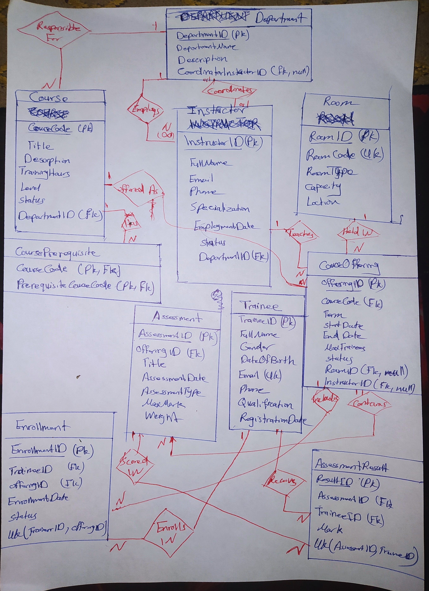

# Technical Training Center Management System

A Microsoft SQL Server database designed and implemented as a team project for the Database Systems course. The system manages the operations of a technical training center: departments, instructors, courses, course offerings, rooms, trainees, enrollment, and assessments.

## Overview
- **10 entities** and **13 relationships** in the ER design
- Relational schema normalized to **3NF**
- Full SQL Server implementation: DDL, sample data, validation tests, and queries
- Query portfolio covering joins, aggregation, and subqueries

## Key Design Decisions
- **Enrollment** uses a separate surrogate key (`EnrollmentID`) as its primary key
- **Assessment result validation** (mark range and enrollment check) is implemented with a **trigger**, since it spans multiple tables
- **Department coordinator** is a real foreign key added with `ALTER TABLE` after both tables exist, to resolve the circular dependency between Department and Instructor

## ER Diagram

## Repository Structure
| File | Description |
|---|---|
| `sql/01_DDL.sql` | Database and table creation (DDL), constraints, and keys |
| `sql/02_INSERT.sql` | Sample data insertion |
| `sql/03_Validation_and_Constraint_Testing.sql` | Tests for constraints and trigger validation |
| `sql/04_Required_Queries.sql` | Required query portfolio (Q1–Q16) |
| `docs/er-diagram.png` | Entity-Relationship diagram |
| `docs/project-report.pdf` | Project report |

## How to Run
1. Open **SQL Server Management Studio (SSMS)**.
2. Run the scripts in `sql/` in this order:
   1. `01_DDL.sql`
   2. `02_INSERT.sql`
   3. `03_Validation_and_Constraint_Testing.sql`
   4. `04_Required_Queries.sql`
3. Note: some statements in the validation script are **expected to fail**, to demonstrate that the constraints and trigger work.

## Technologies
- Microsoft SQL Server
- T-SQL
- ER Modeling

## Author
**Omar Siyam** – Computer Engineering student, Islamic University of Gaza
[LinkedIn](https://www.linkedin.com/in/omar-siyam-62a312393)
